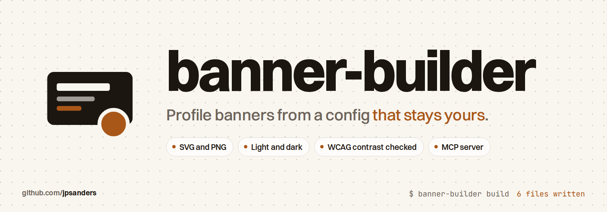
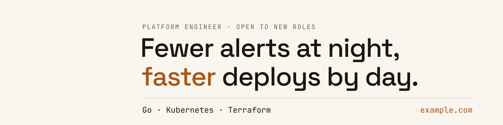
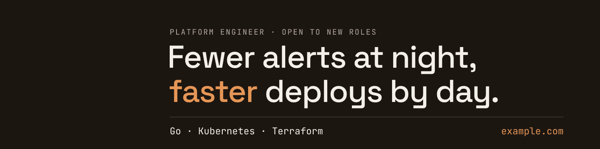

<p align="center">
  <picture>
    <source media="(prefers-color-scheme: dark)" srcset="docs/images/banner-dark.png">
    
  </picture>
</p>

<p align="center">
  <a href="https://github.com/jpsanders/banner-builder/actions/workflows/dev.yml"></a>
  <a href="https://github.com/jpsanders/banner-builder/releases/latest"></a>
  <a href="https://www.python.org/downloads/"></a>
  <a href="#with-an-ai-agent"></a>
  <a href="#with-an-ai-agent"></a>
  
  
  <a href="https://mypy-lang.org/"></a>
  <a href="LICENSE"></a>
  <a href="https://github.com/jpsanders/banner-builder/stargazers"></a>
</p>

Build a profile banner as SVG and PNG from a config file that stays on your machine. LinkedIn's 1584 by 396 by
default, any size you set. Every build checks that the text fits, that each font has every glyph, and that every
colour reaches WCAG AA contrast, before a single file is written.

```sh
uv tool install git+https://github.com/jpsanders/banner-builder@1.0.0
banner-builder init && banner-builder check && banner-builder build
```

<p align="center">
  
  
</p>

Your words, colours and output folder live in one TOML file at `~/.config/banner-builder/banner.toml`, outside any
repository. This repository holds the code and a starter config with placeholder text, nothing else. The fonts ship in
the package and resvg draws the PNG, so a build needs no browser and sends nothing anywhere.

## Install

It needs Python 3.14 or later; uv fetches one if you have none.

```sh
uv tool install git+https://github.com/jpsanders/banner-builder@1.0.0
```

`pipx install git+https://github.com/jpsanders/banner-builder@1.0.0` works too. To try it without installing:
`uvx --from git+https://github.com/jpsanders/banner-builder@1.0.0 banner-builder --help`.

## Use

```sh
banner-builder init     # write the starter config to ~/.config/banner-builder/banner.toml
banner-builder path     # print where the config is, to open it in your editor
banner-builder check    # test the layout and the colours, write nothing
banner-builder build    # write banner-light.svg, banner-light.png, banner-light@2x.png and the dark set
```

`build --out DIR` writes somewhere else for one run. `--theme`, `--format` and `--scale` narrow a build. For example,
`banner-builder build --theme light --format png --scale 2` writes only the file to upload to LinkedIn.

Every command takes `--json` and prints one object, so a script or an agent reads the same facts you do:

```text
$ banner-builder check --json
{"ok": true, "headline_size": 84, "rows": {"kicker": 92, "headline": [180, 271], "rule": 311, "footer": 357},
 "contrast": {"light": {"ink": 16.61, "soft": 5.44, "accent": 4.79}, ...}, "problems": [], ...}
```

## With an AI agent

banner-builder is a Claude Code plugin: a skill that knows the steps, and an MCP server with four tools,
`config_path`, `init`, `check` and `build`. The plugin starts the server through uvx, so nothing needs installing first.

```text
/plugin install banner-builder --marketplace jpsanders/banner-builder
```

On Claude Code before 2.1.275: `/plugin marketplace add jpsanders/banner-builder`, then
`/plugin install banner-builder@banner-builder`. Then ask for what you want: "make my LinkedIn banner say I build
Python services, in green". The agent edits your config, runs `check` until it passes, and builds.

Any other MCP client takes the server directly:

```json
{"mcpServers": {"banner-builder": {"command": "banner-builder", "args": ["mcp"]}}}
```

The skill is plain Markdown in [`skills/banner-builder/SKILL.md`](skills/banner-builder/SKILL.md), so Codex, OpenCode
and other agents that read skills can use it as it is. `check` and `config_path` are marked read only; `init` is marked
destructive, because with `force` it replaces a config.

## The config

Only `[text] lines` is required. The starter config documents every other key next to its default.

```toml
[text]
kicker = "PLATFORM ENGINEER · OPEN TO NEW ROLES"
lines = [
  "Fewer alerts at night,",
  "*faster* deploys by day.",
]
footer_left = "Go · Kubernetes · Terraform"
footer_right = "example.com"
```

- Words between asterisks are drawn in the accent colour.
- The headline is drawn as large as the canvas allows, up to `max_headline`.
- Colours are `#rrggbb` or `oklch(L C H)`. Change one colour of the light or dark theme, or add a theme of your own
  with all five: background, ink, soft, rule and accent.
- `--config PATH` or the `BANNER_BUILDER_CONFIG` variable points at another file. `XDG_CONFIG_HOME` is respected.

## Your config stays yours

- `init` writes the config to your home folder, not to the folder you run it in.
- `init` and `check` warn when the config sits inside a git repository, where a commit would publish it.
- The repository's `.gitignore` ignores `banner.toml`, `*.local.toml` and banner files in its root, for anyone who
  builds from a clone.
- The tool makes no network requests.

## What it checks

`check` and `build` stop before anything is written when one of these fails.

| Check | Rule |
| --- | --- |
| Width | The kicker and the footer fit between the margins. The headline is sized to fit. |
| Height | The last row stays `bottom` pixels clear of the bottom edge. The headline shrinks to keep it, down to 24px. |
| Glyphs | Each font has every character it is asked to draw. |
| Contrast | Ink, soft and accent reach 4.5:1 against the background in every theme built, the WCAG AA minimum. |

## The manual

`banner-builder guide` prints the full manual, every command, option and config key, written for people and agents
alike. `banner-builder man` shows it as a man page, and `banner-builder man --install` makes `man banner-builder`
work. The source is [`docs/MANUAL.md`](docs/MANUAL.md).

## Layout

The default canvas is LinkedIn's, 1584 by 396 pixels. The profile photo covers its bottom left corner, so the text
starts 448 pixels in. Any other size works: set the width, height and margins under `[canvas]`.

`top` is the distance from the top edge to the top of the first capitals. The headline starts 1.45 kicker sizes below
the kicker, and each further line sits 1.08 headline sizes below the one before. The rule and the footer follow,
spaced in footer sizes. Each headline line moves left by the side bearing of its first letter, so its ink lines up with
the kicker and the footer.

## SVG and PNG

The SVG embeds a subset of each font as woff2, so it looks the same in any browser and inside an `` tag. resvg
draws the PNG from that same SVG, with the same fonts handed over as files under the family names the SVG asks for. The
two outputs use the same outlines.

## Fonts

Space Grotesk draws the headline and JetBrains Mono draws the rest. Both are bundled under the SIL Open Font License
1.1, with the licence texts beside the font files in `src/banner_builder/fonts`. Point `[fonts]` at any TTF or OTF file
to use another font. A variable font is pinned to the weight you set.

## Develop

```sh
make init-dev
make checks
```

`make checks` runs isort, black, editorconfig-checker, darglint, flake8, mypy in strict mode, bandit, the man page
check and pytest. CI runs the tests on Python 3.14 and 3.15 on Linux and macOS, then installs the built package on its
own, builds a banner from the starter config and asks the MCP server to check it. `make examples` redraws the images
at the top of this page. See [CONTRIBUTING.md](CONTRIBUTING.md) and [AGENTS.md](AGENTS.md).

## How it was made

I specified it for my own LinkedIn banner and verified it against the banner it replaced: the same sizes, the same rows,
no browser. My own config lives on my machine, the same way yours will.

## Star history

<a href="https://star-history.com/#jpsanders/banner-builder&Date">
  <picture>
    <source media="(prefers-color-scheme: dark)" srcset="https://api.star-history.com/svg?repos=jpsanders/banner-builder&type=Date&theme=dark">
    
  </picture>
</a>

## Licence

MIT for the code. The bundled fonts are under the SIL Open Font License 1.1. Made by
[James Phillip Sanders](https://jamesphillipsanders.com).
