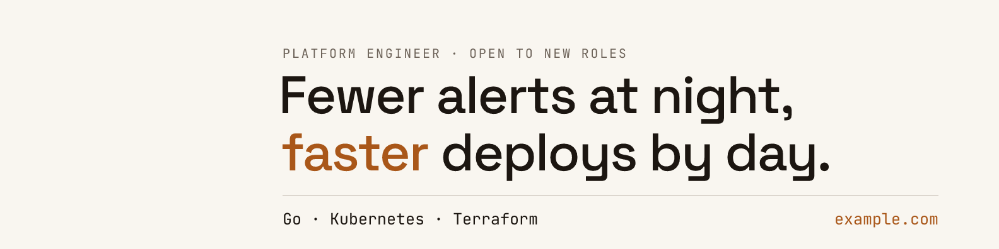
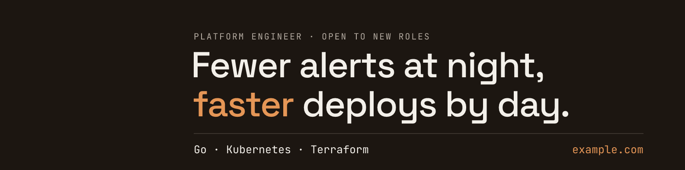

# banner-builder

Build a profile banner as SVG and PNG from a config file that stays on your machine.





Your words, colours and output folder live in one TOML file at `~/.config/banner-builder/banner.toml`, outside any
repository. This repository holds the code and a starter config with placeholder text, nothing else. The fonts ship in
the package and resvg draws the PNG, so a build needs no browser and sends nothing anywhere.

## Install

It needs Python 3.12 or later.

```bash
uv tool install git+https://github.com/jpsanders/banner-builder
```

`pipx install git+https://github.com/jpsanders/banner-builder` works too.

## Use

```bash
banner-builder init     # write the starter config to ~/.config/banner-builder/banner.toml
banner-builder path     # print where the config is, to open it in your editor
banner-builder check    # test the layout and the colours, write nothing
banner-builder build    # write banner-light.svg, banner-light.png, banner-light@2x.png and the dark set
```

`build --out DIR` writes somewhere else for one run. `--theme`, `--format` and `--scale` narrow a build. For example,
`banner-builder build --theme light --format png --scale 2` writes only the file to upload to LinkedIn.

## The config

Only `[text] lines` is required. The starter config documents every other key next to its default.

```toml
[text]
kicker = "PLATFORM ENGINEER · OPEN TO NEW ROLES"
lines = [
  "Fewer alerts at night,",
  "*faster* deploys by day.",
]
footer_left = "Go · Kubernetes · Terraform"
footer_right = "example.com"
```

- Words between asterisks are drawn in the accent colour.
- The headline is drawn as large as the canvas allows, up to `max_headline`.
- Colours are `#rrggbb` or `oklch(L C H)`. Change one colour of the light or dark theme, or add a theme of your own
  with all five: background, ink, soft, rule and accent.
- `--config PATH` or the `BANNER_BUILDER_CONFIG` variable points at another file. `XDG_CONFIG_HOME` is respected.

## Your config stays yours

- `init` writes the config to your home folder, not to the folder you run it in.
- `init` and `check` warn when the config sits inside a git repository, where a commit would publish it.
- The repository's `.gitignore` ignores `banner.toml`, `*.local.toml` and banner files in its root, for anyone who
  builds from a clone.
- The tool makes no network requests.

## What it checks

`check` and `build` stop before anything is written when one of these fails.

| Check | Rule |
| --- | --- |
| Width | The kicker and the footer fit between the margins. The headline is sized to fit. |
| Height | The last row stays `bottom` pixels clear of the bottom edge. The headline shrinks to keep it, down to 24px. |
| Glyphs | Each font has every character it is asked to draw. |
| Contrast | Ink, soft and accent reach 4.5:1 against the background in every theme built, the WCAG AA minimum. |

## Layout

The default canvas is LinkedIn's, 1584 by 396 pixels. The profile photo covers its bottom left corner, so the text
starts 448 pixels in. Any other size works: set the width, height and margins under `[canvas]`.

`top` is the distance from the top edge to the top of the first capitals. The headline starts 1.45 kicker sizes below
the kicker, and each further line sits 1.08 headline sizes below the one before. The rule and the footer follow,
spaced in footer sizes. Each headline line moves left by the side bearing of its first letter, so its ink lines up with
the kicker and the footer.

## SVG and PNG

The SVG embeds a subset of each font as woff2, so it looks the same in any browser and inside an `` tag. resvg
draws the PNG from that same SVG, with the same fonts handed over as files under the family names the SVG asks for. The
two outputs use the same outlines.

## Fonts

Space Grotesk draws the headline and JetBrains Mono draws the rest. Both are bundled under the SIL Open Font License
1.1, with the licence texts beside the font files in `src/banner_builder/fonts`. Point `[fonts]` at any TTF or OTF file
to use another font. A variable font is pinned to the weight you set.

## Develop

```bash
make init-dev
make checks
```

`make checks` runs isort, black, editorconfig-checker, darglint, flake8, mypy in strict mode, bandit and pytest. CI runs
the same checks, runs the tests on Python 3.12, 3.13 and 3.14, and installs the built wheel on its own to prove it
ships the fonts and the starter config. `make examples` redraws the images at the top of this page.

## How it was made

I specified it for my own LinkedIn banner and verified it against the banner it replaced: the same sizes, the same rows,
no browser. My own config lives on my machine, the same way yours will.

Issues and pull requests are welcome.

[James Phillip Sanders](https://jamesphillipsanders.com)

## License

MIT for the code. The bundled fonts are under the SIL Open Font License 1.1.
